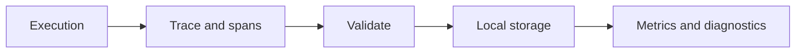

# traceOps

**Every AI decision leaves evidence.**

Local-first AI observability toolkit for tracing, metrics, storage and diagnostics.

  [](https://github.com/ops-universe/traceOps/actions/workflows/ci.yml)

> Development source repository. Public release is deferred. See [implementation status](docs/status/IMPLEMENTATION-STATUS.md) for scoped evidence and limitations.

## Why traceOps?

Inspect execution paths and timing evidence with a local, synthetic-first workflow before introducing external observability systems.

## Features

- Versioned trace and span contracts, relationships and timing validation.
- Nested instrumentation, lifecycle tracking and aggregate metrics.
- Local storage, explicit retention, inspection and trace comparison.
- Synthetic dashboard, redacted browser imports and enterprise examples.

## Architecture



[Architecture](docs/architecture/overview.md) · [Metrics](docs/architecture/metrics.md) · [Dashboard](docs/architecture/dashboard.md) · [Diagnostics](docs/architecture/diagnostics.md)

## Quickstart

Requires Node.js 22+ and npm. Work from the repository root; the package is private and not presented as an npm release.

```sh
git clone https://github.com/ops-universe/traceOps.git
cd traceOps
npm ci
npm test
npm run demo
```

## CLI and examples

Use synthetic fixtures only.

```sh
node src/cli.mjs --help
npm run demo
```

## Configuration

CLI commands: `inspect FILE TRACE_ID`, `compare FILE BEFORE_ID AFTER_ID`, and `metrics FILE`. Supply trusted trace files. See [storage and retention](docs/architecture/storage.md) and [instrumentation](docs/architecture/instrumentation.md). Retention is explicit, not automatic.

## Scope and limitations

Use trusted, redacted inputs and directories. Browser import retains identifiers and numeric evidence; CLI/storage imports may contain sensitive data. Concurrent writers and hostile directory mutation are outside guarantees. OpenTelemetry-inspired identifiers do not establish OTLP interoperability. No production or security certification.

Read the [threat model](docs/security/threat-model.md) before integrating with real data or systems.

## Roadmap

See [ROADMAP.md](ROADMAP.md) and [implementation status](docs/status/IMPLEMENTATION-STATUS.md). Developer Preview launch and public release remain deferred.

## Contributing and support

Read [CONTRIBUTING.md](CONTRIBUTING.md), [Code of Conduct](CODE_OF_CONDUCT.md), and [SECURITY.md](SECURITY.md). Open a focused [issue](https://github.com/ops-universe/traceOps/issues) with a minimal synthetic reproduction or documentation proposal. Run `npm ci` and `npm test` before opening a focused PR. Report security concerns using the security policy rather than public issues.

## Related projects

[evalOps](https://github.com/ops-universe/evalOps) · [guardOps](https://github.com/ops-universe/guardOps) · [ragOps](https://github.com/ops-universe/ragOps) · [mcpOps](https://github.com/ops-universe/mcpOps) · [workflowOps](https://github.com/ops-universe/workflowOps) · [dataOps](https://github.com/ops-universe/dataOps) · [Ops Universe](https://github.com/ops-universe)

## License

[MIT](LICENSE)
